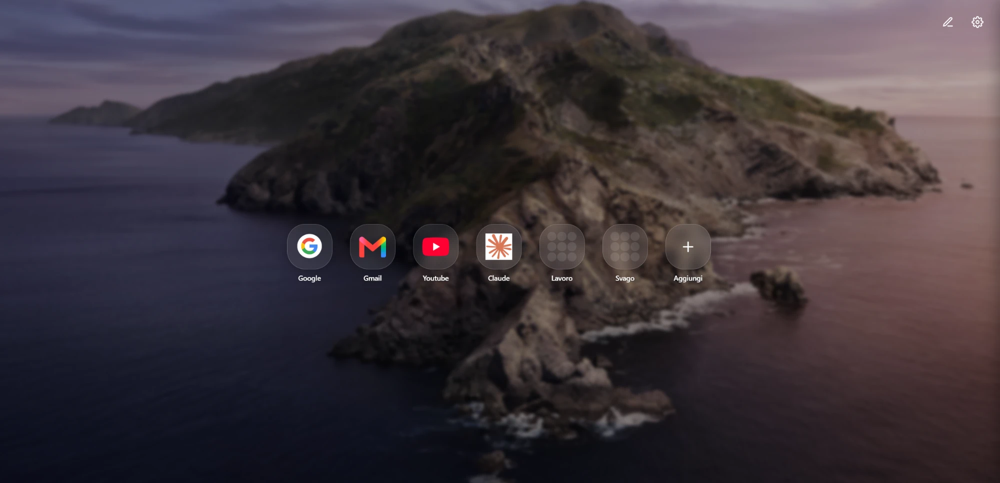

<p align="center">
  
</p>

<h1 align="center">FranzTAB</h1>

<p align="center">
  Una nuova scheda minimale per Chrome ed Edge: griglia di collegamenti e cartelle, personalizzabile e utilizzabile anche offline.
</p>

<p align="center">
  
</p>

---

## Funzionalità

- **Collegamenti e cartelle** in stile app, riordinabili con il trascinamento
- **Più pagine** navigabili con le frecce o con la rotellina
- **Griglia responsive**: le icone mantengono la dimensione scelta, colonne e righe si adattano alla finestra e ciò che non entra passa alla pagina successiva
- **Icone automatiche** dei siti con varianti e ritaglio, oppure immagine personalizzata
- **Anteprima dal vivo** nel modale di aggiunta/modifica
- **Sfondo** a tinta unita o immagine, con luminosità e sfocatura regolabili; il colore dei titoli si adatta alla luminosità dello sfondo
- **Tema** chiaro, scuro o automatico; stile dei riquadri (colore, opacità, bordo, ombra, hover) personalizzabile
- **Offline**: le icone vengono salvate in cache locale; un badge segnala l'assenza di connessione
- **Backup** e ripristino completo in un file JSON

## Installazione

### Dagli store
- Microsoft Edge Add-ons — *in revisione*
- Chrome Web Store — *in arrivo*

### Da sorgente
1. Clona il repository
   ```bash
   git clone https://github.com/FranzGra/FranzTAB.git
   ```
2. Apri `chrome://extensions` (o `edge://extensions`)
3. Attiva **Modalità sviluppatore**
4. Clicca **Carica estensione non pacchettizzata** e seleziona la cartella del progetto

## Utilizzo

| Azione | Come |
| --- | --- |
| Aggiungere un elemento | Pulsante **+** in fondo alla griglia |
| Modificare / eliminare | Tasto destro sull'elemento, oppure modalità modifica (matita in alto) |
| Riordinare | Trascina le icone in modalità modifica |
| Cambiare pagina | Frecce laterali o rotellina del mouse |
| Impostazioni | Ingranaggio in alto a destra |
| Chiudere una cartella | Freccia indietro o `Esc` |

## Struttura del progetto

```
manifest.json     Manifest V3
index.html        Pagina della nuova scheda
script.js         Logica: rendering, impostazioni, cache icone, backup
style.css         Stili
background.js     Service worker: scarica le favicon per la cache offline
Sortable.min.js   Trascinamento (SortableJS)
icons/            Icone dell'estensione
_locales/         Nome e descrizione tradotti (en, it)
docs/             Informativa privacy (GitHub Pages)
store/            Testi per le schede degli store
```

## Creare il pacchetto per gli store

```bash
powershell -Command "Compress-Archive -Path manifest.json,index.html,script.js,style.css,background.js,Sortable.min.js,icons,_locales -DestinationPath FranzTAB-1.0.0.zip -Force"
```

Ricorda di aumentare `version` in `manifest.json` a ogni nuova pubblicazione.

## Privacy

FranzTAB non raccoglie dati: tutto resta in `chrome.storage.local`. Le uniche richieste di rete sono verso servizi pubblici di favicon, inviando solo il dominio del sito. Dettagli nell'[informativa sulla privacy](https://franzgra.github.io/FranzTAB/privacy.html).

## Roadmap

- Server di sincronizzazione self-hosted tra più dispositivi

## Licenza

FranzTAB è distribuito con licenza [GNU AGPL v3.0](LICENSE).

## Crediti

- [SortableJS](https://github.com/SortableJS/Sortable) — licenza MIT
